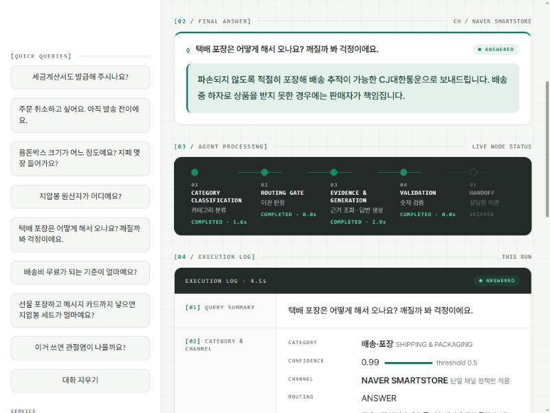

# Mode:N(모든) 고객응대 라우팅 에이전트

용돈박스 + 옥 지압봉을 네이버 스마트스토어에서 파는 **가상 스토어 Mode:N(모든)** 의 고객 문의를 분류하고, 카테고리별 근거 문서만 읽어 답하고, 답변 속 숫자를 검증하는 LangGraph 에이전트예요. 근거가 없거나 확신이 없으면 지어내지 않고 상담원에게 넘겨요.

```
문의 → 분류(classify) → 넘기기 판단(gate) → 근거 조회 + 답변(answer ⇄ tools) → 검증(guard)
                              ↓                        ↓
                       범위 밖 · 확신 낮음         근거 없음 → 이관(escalate)
```



## 결과 한눈에 보기

평가용 25건을 같은 조건으로 두 번 측정한 최종 결과예요. 개선 과정과 틀린 건 분석은 [REPORT.md](REPORT.md)에 있어요.

| 지표 | 결과 |
|---|---|
| 도구 호출 적절성 (호출한 도구 집합이 기대 도구와 정확히 일치) | 23/25 (92%), 두 번 모두 |
| 답변 적절성 (필수 사실을 모두 담고 금지 사항을 어기지 않음) | 21/25, 22/25 (84%, 88%) |
| 넘기기가 정답인 7건 | 도구 7/7 |

## 실행 방법 (약 3분)

> **키가 없어도 볼 수 있는 것**: [REPORT.md](REPORT.md)(설계·측정·구조도), [results/](results/)(측정 결과 원본), 아래 ①②번 명령.
> **OpenAI API 키가 있으면**: ③데모와 ④측정 재현까지 모두 실행할 수 있어요.

### 0. 준비물

| 항목 | 내용 |
|---|---|
| Python | 3.14.7에서 확인했어요. 다른 버전은 확인하지 못했어요. |
| OpenAI API 키 | ③④번에만 필요해요. 모델 호출 비용은 평가 한 번에 아주 적어요. |
| 네트워크 | 모델 호출과 데모의 폰트(Pretendard) 로딩에 써요. |

### 1. 설치

```bash
git clone https://github.com/hojitea-ui/my-routing-agent.git
cd my-routing-agent
pip install -r requirements.txt
```

### 2. 키 설정 (③④번만)

```bash
cp .env.example .env            # Windows: copy .env.example .env
```

`.env` 파일을 열어 `OPENAI_API_KEY=` 뒤에 키를 붙여 넣으세요. `.env`는 저장소에 올라가지 않아요.

### 3. 실행

| # | 하고 싶은 것 | 키 | 명령 | 이렇게 나오면 정상 |
|---|---|---|---|---|
| ① | 문서 쪼개기·근거 분리 확인 | 불필요 | `python context.py` | `분리됨 ✅` 4줄 |
| ② | 파이프라인 구조도(Mermaid) | 불필요 | `python agent.py --graph` | `graph TD;`로 시작하는 코드 |
| ③ | 문의 한 건 처리 | 필요 | `python agent.py "택배사는 어디고 보통 며칠 걸려요?"` | 답변과 `action=ANSWER tools=['get_shipping_info']` |
| ③ | 데모 화면 | 필요 | `streamlit run app.py` | 브라우저에서 http://localhost:8501 |
| ④ | 채점기 검증 | 필요 | `python evaluate.py --validate-judge` | `모범 답안 25건 중 통과 25 / 실패 0` |
| ④ | 평가용 25건 측정 | 필요 | `python evaluate.py --tag run` | 도구 23/25 안팎, 답변 21–22/25 안팎 |

- **점수는 실행마다 1건 정도 흔들려요.** 답변 20–23/25 범위면 보고서와 같은 결과예요(자세한 이유는 REPORT 4.6).
- ④를 처음 하신다면 `--validate-judge`를 먼저 돌려 채점기가 정상인지 보세요. 두 번째 줄에 `통과(=잘못 통과) 1건 ['E-X-04']`처럼 1건 안팎이 나오는 건 알려진 현상이에요(이관 문항들의 필수 사실이 같아서 생겨요).
- 결과는 `results/run.json`에 저장돼요. 20초 안팎이 걸려요.
- 데모에서는 사이드바의 예시 문의나 아래쪽 카테고리 카드를 누르면 바로 실행돼요.

### 막혔을 때

| 증상 | 해결 |
|---|---|
| `OPENAI_API_KEY가 없어요` | 2번을 하세요. `.env`는 프로젝트 폴더(이 README가 있는 곳)에 있어야 해요. |
| 모델을 찾을 수 없다는 오류 | 계정에서 교안 모델이 안 열리는 거예요. `.env`에 `ROUTE_MODEL=`, `ANSWER_MODEL=`로 쓰는 모델을 지정하고 `ANSWER_REASONING=`(빈 값)으로 두세요. |
| `streamlit`을 찾을 수 없음 (Windows) | `python -m streamlit run app.py`로 실행하세요. |
| 콘솔에서 한글이 깨짐 | 명령 프롬프트는 `set PYTHONIOENCODING=utf-8`, PowerShell은 `$env:PYTHONIOENCODING="utf-8"`을 먼저 입력하세요. |
| 데모 글꼴이 다르게 보임 | 오프라인이면 Pretendard 대신 시스템 글꼴로 나와요. 기능에는 영향이 없어요. |

**확인한 환경**: Python 3.14.7, langchain 1.4.7, langchain-core 1.7.0, langchain-openai 1.7.3, langgraph 1.2.18, pydantic 2.13.5, python-dotenv 1.2.3, streamlit 1.66.1.

## 모델 설정

기본값은 교안과 같은 등급이에요. `.env`에 아래 이름으로 적거나 환경변수로 지정하면 바꿀 수 있어요.

| 환경변수 | 기본값 | 용도 |
|---|---|---|
| `ROUTE_MODEL` | `gpt-5.6-luna` | 카테고리 분류 |
| `ANSWER_MODEL` | `gpt-5.6-terra` | 도구 선택 · 답변 · 이관 답변 |
| `JUDGE_MODEL` | `ANSWER_MODEL`과 같음 | 답변 채점 |
| `ANSWER_REASONING` | `none` | 교안 모델은 추론 모드와 도구 호출을 함께 못 써서 끈다. 다른 모델을 쓰면 빈 값으로 둔다 |

계정에서 위 모델이 열리지 않으면 다른 모델명을 지정하세요. 점수는 모델에 따라 달라질 수 있어요.

## 구성

| 경로 | 역할 |
|---|---|
| [docs/policy.md](docs/policy.md) | 근거 문서(업무 매뉴얼 v0.2). 네이버 스마트스토어 판매 이용약관을 풀어 썼고, 약관에 없는 값은 `[A]`(가정 각주), 근거를 못 찾은 것은 `[확인 필요]`로 표시 |
| [data/goldenset.json](data/goldenset.json) | 평가셋: 평가용 25 + 예시용 10 (기대 도구, 필수 사실, 금지 사항, 모범 답안) |
| [prompts.py](prompts.py) | 분류 지침 · 답변 규칙 · 이관 답변 규칙 |
| [context.py](context.py) | 문서를 장 단위로 쪼개고 도구별 근거를 조립 |
| [agent.py](agent.py) | LangGraph 파이프라인 · 도구 · 숫자 출처 가드레일 |
| [evaluate.py](evaluate.py) | 두 지표 측정 · 채점기 검증 · 재채점 |
| [app.py](app.py) · [assets/style.css](assets/style.css) | Streamlit 데모와 디자인 토큰 |
| [results/](results/) | 측정 결과 JSON과 개선 기록([LOG.md](results/LOG.md)) |
| [REPORT.md](REPORT.md) | 설계 결정 · 측정 결과 · 구조도 · 회고 |

## 알아 둘 점

- **가상의 스토어예요.** 가격, 상품 사양, 택배사, 반품 배송비 같은 값 42건은 약관에 없어서 가정한 값이고, 문서에 `[A]` 각주로 표시했어요. 실제 사업 정보는 들어 있지 않아요.
- **약관은 요약해서 재서술했어요.** 원문을 복사하지 않았어요. 출처는 문서 꼬리표(`[약관 제N조]`)와 부록 B에 있어요.
- **점수는 실행마다 1건 정도 흔들려요.** 평가셋이 25건이라서, 한두 건 차이는 효과로 보지 않았어요(자세한 한계는 REPORT 4.6).
- **데모는 실제 노드 상태를 보여 줘요.** 처리 단계 표시는 가짜 진행률이 아니라 그래프가 끝낸 노드를 반영해요.

## 출처와 라이선스

**근거 문서**
- 네이버 스마트스토어 **판매 이용약관**(공지 2026-05-26, 적용 2026-06-29)과 **판매 이용규칙**: [스마트스토어센터](https://sell.smartstore.naver.com/#/terms/agreement)에 공개된 문서예요. 저작권은 네이버(주)와 네이버파이낸셜(주)에 있어요.
- [docs/policy.md](docs/policy.md)는 위 약관을 **구매자 응대용으로 요약·재서술**한 것이고 원문을 복사하지 않았어요. 어느 문장이 어느 조항에서 왔는지는 문장 끝 꼬리표(`[약관 제N조]`)와 부록 B에 있어요. 약관 원문은 바뀔 수 있으니 실제 운영에는 최신 원문을 확인하세요.
- 약관에 없는 가격, 사양, 택배사 같은 값은 이 프로젝트에서 정한 **가상값**(`[A]` 각주)이에요.
- 설계 구조(분류 → 근거 조립 → 답변 → 검증, 평가 방식)는 수업 교안 「고객 응대 에이전트 만들기」를 참고했어요. 교안의 문서와 데이터는 이 저장소에 포함하지 않았어요.

**폰트**
- [Pretendard](https://github.com/orioncactus/pretendard) (SIL Open Font License 1.1). 데모 화면이 열릴 때 jsDelivr CDN에서 불러오고 파일은 저장소에 넣지 않았어요. 오프라인이면 시스템 한글 글꼴로 대체돼요.

**아이콘**
- 카테고리 카드의 아이콘은 `app.py`에 직접 작성한 단순 선 SVG예요. 외부 아이콘 라이브러리의 파일을 가져오지 않았어요.

**주요 라이브러리** (설치 시 `pip`가 가져와요. 라이선스는 설치된 버전의 패키지 메타데이터 기준이에요)

| 라이브러리 | 용도 | 라이선스 |
|---|---|---|
| [LangChain](https://github.com/langchain-ai/langchain), `langchain-openai` | 모델 호출, 도구 정의 | MIT |
| [LangGraph](https://github.com/langchain-ai/langgraph) | 파이프라인 그래프 | MIT |
| [Pydantic](https://github.com/pydantic/pydantic) | 구조화된 출력 스키마 | MIT |
| [python-dotenv](https://github.com/theskumar/python-dotenv) | `.env` 읽기 | BSD-3-Clause |
| [Streamlit](https://github.com/streamlit/streamlit) | 데모 화면 | Apache-2.0 |

**모델과 API**
- 분류·답변·채점에 OpenAI API를 써요. 모델과 API 사용에는 OpenAI의 이용약관이 적용돼요. API 키는 `.env`에만 두고 저장소에 올리지 않아요.

**이 저장소의 코드**
- 과제 제출용이고 별도 라이선스를 지정하지 않았어요.
