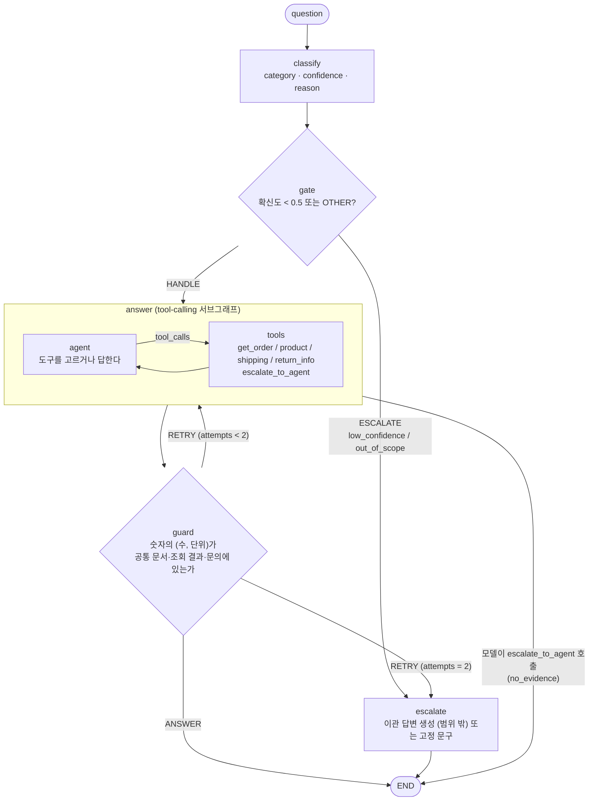
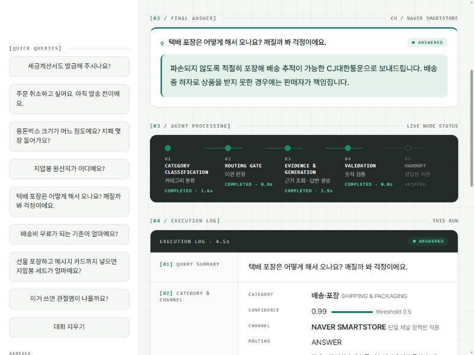
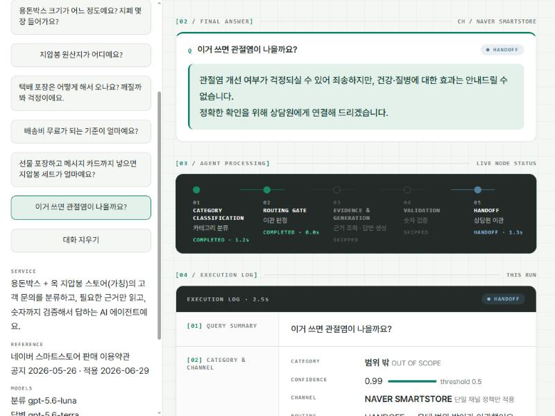

# Mode:N(모든) 고객응대 라우팅 에이전트

용돈박스 + 옥 지압봉을 네이버 스마트스토어에서 파는 가상 스토어 Mode:N(모든)의 고객 문의를 **분류 → 카테고리별 근거 조립 → 근거만으로 답변 → 숫자 검증**하고, 확신이 없거나 근거가 없으면 상담원에게 넘기는 LangGraph 에이전트예요.

```
문의 → ① 카테고리 판정 → ② 넘기기 판단 → ③ 근거 조립 + 답변 → ④ 검증
                              ↓                    ↓
                        범위 밖·확신 낮음      근거 없음 → 이관
```

## 실행 방법

```bash
pip install -r requirements.txt
cp .env.example .env            # OPENAI_API_KEY 를 채운다 (.env 는 저장소에 올리지 않는다)
python agent.py "택배사는 어디고 보통 며칠 걸려요?"      # 문의 하나
python evaluate.py --validate-judge                     # 채점기를 모범 답안으로 먼저 검증
python evaluate.py --tag run                            # 평가용 25건 측정 → results/run.json
streamlit run app.py                                    # 데모 화면
```

모델은 교안과 같은 등급(분류 `gpt-5.6-luna`, 답변·채점 `gpt-5.6-terra`)을 기본값으로 쓰고, 환경변수(`ROUTE_MODEL`, `ANSWER_MODEL`, `JUDGE_MODEL`)로 바꿀 수 있어요. 아래 수치는 이 모델로 2026-11-03에 측정한 값이에요. 다른 모델에서는 점수가 달라질 수 있어요.

```
my-routing-agent/
├── docs/policy.md          # 근거 문서 (업무 매뉴얼 v0.2)
├── data/goldenset.json     # 평가셋: 평가용 25 + 예시용 10
├── prompts.py              # 분류 지침 · 답변 규칙 · 이관 답변 규칙
├── context.py              # 문서 쪼개기 · 도구별 근거 조립
├── agent.py                # 파이프라인 (LangGraph)
├── evaluate.py             # 두 지표 측정 · 채점기 검증 · 재채점
├── app.py                  # 데모 화면 (Streamlit)
├── assets/style.css        # 데모 디자인 토큰·스타일
├── results/                # 측정 결과(JSON)와 개선 기록(LOG.md)
├── requirements.txt
└── REPORT.md
```

---

## 1. 주제와 근거 문서

**주제**: 예정 사업(1688에서 소싱한 옥 지압봉을 용돈박스와 묶어 "효도 선물"로 재판매)의 고객응대. 구매자(20–30대 자녀)와 사용자(50–60대 부모)가 다른 선물 상품이라 "부모님 주소로 바로 보내면 용돈은?" 같은 이 스토어만의 문의가 생기고, 효능·진위·인증처럼 **문서에 없는데 그럴듯하게 답할 수 있는 질문**이 자연스럽게 나와요. 과제의 세 조건(카테고리별로 답이 다르고, 근거 문서가 충분히 길고, 지어내기 쉬운 질문이 있다)을 모두 채워요.

**근거 문서**: [docs/policy.md](docs/policy.md) (6,732자, 업무 매뉴얼 v0.2)

- 뼈대는 **네이버 스마트스토어 판매 이용약관**(공지 2026-05-26, 적용 2026-06-29)과 **판매 이용규칙**이에요. 약관 제13·17·20·23·24·25·31·42조를 풀어 썼어요. 약관은 판매자가 지켜야 할 의무를 적은 문서라서, 구매자에게 하는 답변으로 **재서술**했고 원문은 복사하지 않았어요(공개 저장소 제출).
- 약관에 없는 값(가격, 택배사, 배송비, 반품 배송비, 상품 사양 등)은 제가 정한 가상값이에요. 문장 끝에 꼬리표로 구분해요.

| 꼬리표 | 뜻 | 개수 |
|---|---|---|
| `[약관 제N조]` · `[판매이용규칙]` | 해당 조항을 풀어 쓴 문장 | 27 · 2 |
| `[A]` (가정 각주) | 약관에 없어 이 스토어가 정한 값 (실제 운영 전 확정 필요) | 42 |
| `[확인 필요]` | 근거를 아직 못 찾은 사항. 단정하지 않고 넘긴다 | 6 |

`[확인 필요]`는 일부러 비워 둔 항목이에요(안전 인증, 환불 입금 시점 등). 에이전트가 이런 질문에 지어내지 않고 넘기는지 평가하는 데 써요.

**문서를 쓰며 정한 것**
- 현금은 구매자가 박스를 받은 뒤 **직접** 넣어요. 판매자는 현금을 취급하지 않아요(분쟁 위험을 문서 수준에서 제거).
- 상품 사양은 미확정이라 가상값을 문서에 직접 적었어요. 실제 사업 정보는 공개 저장소라서 넣지 않았어요.
- 지압봉은 **천연 옥으로 만든 것만** 쓰기로 정했어요(사업 결정, 3.1). 감정서·보증서는 제공하지 않는다는 가정은 그대로예요. 실제로 "천연 옥"이라고 표시하려면 입증 자료가 필요하다는 점은 운영 전 과제로 남겨요.
- 문서 끝의 부록 A(가정 목록), B(출처), C(변경 기록)는 프롬프트에 넣지 않아요.

---

## 2. 카테고리 설계

### 카테고리와 근거 (4 + 범위 밖 1)

문서(약관)가 **다르게 처리하는 단위**로 나눴어요. 고객이 쓰는 단어가 아니라 원하는 결과로 판단해요("반품 배송비 얼마예요?"는 배송비를 묻지만 반품 건이라 RETURN_REFUND).

| 카테고리 | 고객이 원하는 것 | 근거 도구 | 연결한 문서 부분 | 약관 근거 |
|---|---|---|---|---|
| `ORDER` 주문·구성 선택 | 구성·가격, 현금 취급, 메시지 카드, 선물 포장, 결제, 주문 변경·취소 | `get_order_info` | 2장 | 제13·17·31조, 판매이용규칙 |
| `PRODUCT` 상품·사용법 | 지압봉·조화·용돈박스 사양, 사용법, 인증·원산지 | `get_product_info` | 3장 (3.1–3.5) | 제23조 |
| `SHIPPING` 배송·포장 | 발송 시기, 택배사, 배송비, 배송지, 지연, 포장 | `get_shipping_info` | 4장 | 제20·24조 |
| `RETURN_REFUND` 교환·반품·환불 | 신청 방법, 가능 기간, 반품 배송비, 하자, 환불 | `get_return_info` | 5장 | 제25조 |
| `OTHER` 범위 밖 | 의학·효능 상담, 타 판매처 주문, 법적 분쟁, 강한 불만 | `escalate_to_agent` | 6장 | 제42조 |

모든 호출에 **공통으로** 들어가는 장: 문서 사용법(꼬리표 규약), 0장 기본 원칙, 1장 문의 유형 분류, 6장 범위 밖·이관, 7장 응대 태도. 모든 카테고리가 문서의 어느 부분과 연결되어 있고, 연결할 부분이 없는 카테고리는 없어요.

### 근거 조립 결과 (필요한 부분만 넣었는지)

문서 전체 6,732자 중 도구가 호출될 때 프롬프트에 들어가는 길이예요 (공통 장 약 2,170자 포함).

| 호출한 도구 | 컨텍스트 길이 | 전문 대비 |
|---|---|---|
| `get_order_info` | 3,290자 | 48.9% |
| `get_product_info` | 3,027자 | 45.0% |
| `get_shipping_info` | 2,867자 | 42.6% |
| `get_return_info` | 3,234자 | 48.0% |
| `escalate_to_agent` | 2,168자 | 32.2% |

공통 장이 커서 절반 아래로는 안 내려가지만, **다른 카테고리의 값이 섞여 들어가지 않는지** 문자열로 확인했어요 (`python context.py`). 반품 배송비 "왕복 6,000원", 선물 포장 금액, 택배사, 지압봉 길이가 각자의 도구 컨텍스트에만 있고 서로 섞이지 않아요.

### 카테고리를 이렇게 나눈 이유와 한계

- **약관의 구분을 따랐어요.** 배송(제24조), 취소·반품·교환·환불(제25조), 상품 정보(제23조), 결제·직거래(제31조)가 각자 다른 규칙을 가져서, 카테고리마다 답이 실제로 달라요.
- **더 잘게 나누지 않았어요.** 문서가 6.7천 자라 5개를 넘기면 일부 카테고리의 근거가 한두 문장이 돼요.
- **한계**: 실제 고객 문의 분포 데이터가 없어서 문의 빈도로 나눈 근거는 없어요. 구분 기준은 문서 구조와 처리 방식뿐이에요.

### 넘기기가 두 겹이에요

| 어디서 | 판단 | 예 |
|---|---|---|
| 분류 단계(`gate`) | 확신도 0.5 미만이거나 `OTHER`이면 넘김 | 법적 분쟁, 타 판매처 주문 |
| 답변 단계(모델) | 분류는 확실한데 문서에 근거가 없으면 `escalate_to_agent` 호출 | KC 인증이 있나요?, 현금을 넣어 반품했는데 없어졌어요 |

카테고리를 고르는 일과 넘기는 판단을 분리했고, 두 경로를 따로 측정할 수 있어요.

---

## 3. 평가셋 설계

[data/goldenset.json](data/goldenset.json) — **평가용 25건 + 예시용 10건**

| | ORDER | PRODUCT | SHIPPING | RETURN_REFUND | OTHER | 합계 |
|---|---|---|---|---|---|---|
| 평가용(`E-*`) | 5 | 5 | 5 | 5 | 5 | 25 |
| 예시용(`F-*`) | 2 | 2 | 2 | 2 | 2 | 10 |

문항마다 `question`, `category`, **기대 도구** `expected_tools`, **필수 사실** `must_facts`, **말하면 안 되는 것** `forbid`, 모범 답안 `reference`, 근거 위치 `source`를 적었어요.

### 무엇을 근거로 정했나

- **문서를 먼저 다 쓴 뒤에** 문항을 만들었어요. 문서 문장을 그대로 베끼지 않고 고객 말투로 풀었어요.
- **기대 도구**는 답에 필요한 사실이 들어 있는 장이에요. 필수 사실은 그 장의 문장에서 따왔고, `source` 필드에 절 번호(예: `policy 5.3`)를 남겼어요.
- **금지 사항**에는 문서를 안 읽었을 때 나오기 쉬운 그럴듯한 오답을 넣었어요. 반품 기간 14일·30일(실제 7일), 배송 도서산간 추가비 5,000원(실제 3,000원), 선물 포장 무료 등이에요. 효능 문항은 "혈액순환에 도움" 같은 말을 금지해요.
- **넘기는 게 정답인 문항 7건(28%)**: 범위 밖 5건(효능, 타 판매처, 강한 불만, 법적 분쟁, 사업자번호)과 카테고리 안에서 근거가 없는 2건(KC 인증, 현금 든 채 반품한 뒤 분실). 문서에 답이 없는 질문이 있어야 넘기기 경로를 평가할 수 있어요. ("진짜 천연 옥인가요?" E-P-03은 처음에는 넘기는 문항이었는데, 천연 옥만 쓰기로 정하면서 답변 문항으로 바꿨어요. 아래 수정 기록 참고)
- **복합 문항 2건**(도구 2개가 정답): E-S-05(선물 포장 + 배송 시기), E-R-05(포장비 환불 + 반품). 도구를 덜 부르거나 더 부르는 경우를 걸러 내요.

### 평가용과 예시용을 어떻게 갈랐나

- 프롬프트의 분류 예시는 `prompts.py`가 `split == "fewshot"`인 문항에서만 가져와요.
- 점검: fewshot id가 모두 `F-*`, 평가 질문 25건이 프롬프트에 들어간 건 0건, 평가·예시 질문 사이 최대 문자 유사도 0.26(거의 겹치는 쌍 없음). 평가용 모범 답안 중 2건이 프롬프트와 겹쳤는데 둘 다 표준 이관 문구 한 문장이라 누수가 아니에요.
- 개선할 때도 프롬프트에 평가 문항의 사례를 넣지 않고 일반 표현만 썼어요.

### 평가셋을 고친 기록 (모두 goldenset.json의 `changelog`에 있음)

| 시점 | 무엇을 | 이유 |
|---|---|---|
| 에이전트 측정 **전** | E-R-03 모범 답안, E-R-04·E-X-04 필수 사실 수정 | 채점기 검증에서 모범 답안이 3건 떨어졌는데, 채점기가 아니라 평가셋이 문제였음(모범 답안에 사실 누락, 고객에게 말할 필요 없는 근거 설명이 필수 사실에 섞임) |
| 측정 **후** | E-R-04 필수 사실을 "현금 분실 건은 상담원에게 연결한다"로 축소 | 원래 필수 사실이 5장에 있는데 기대 도구는 이관뿐이라, 이관만 하는 에이전트는 알 수 없는 사실이었음. 모델이 아니라 평가셋의 결함. 이전 측정은 `--rejudge`로 같은 기준에서 다시 채점해 비교 |
| 측정 **후** | E-P-03을 넘기기 문항에서 답변 문항으로 변경(기대 도구 `get_product_info`, 필수 사실 "천연 옥만 사용한다") | 사업 결정: 지압봉을 천연 옥만 쓰기로 정해 문서 3.1에 확정했고, 근거가 생겨 답할 수 있는 질문이 됨. 이 문항의 이전 점수는 새 기준과 비교하지 않고, 이전 측정은 이 문항을 뺀 24건으로 환산해 비교 |

결과를 본 뒤의 수정은 점수를 부풀릴 수 있어서, **모델과 무관하다는 근거가 있는 한 건만** 고쳤어요. 기대 도구가 모호한 E-S-03은 일부러 고치지 않았어요(4장 참고).

---

## 4. 측정 결과

### 4.1 채점기를 먼저 검증했어요

답변 적절성은 LLM 채점기가 표현이 아니라 **사실**을 보고 판정해요. 같은 뜻이면 표현이 달라도, 숫자 표기가 달라도(3만원 = 30,000원) 인정하고, 금지 내용을 부정하는 문맥("무료가 아닙니다")은 위반으로 보지 않아요.

- 모범 답안 25건을 넣으면 **25/25 통과**(수정 후). 처음에는 3건이 떨어졌고, 원인은 위 표의 평가셋 결함이었어요.
- 다른 문항의 답안을 넣었을 때 잘못 통과한 건은 1건(E-X-04)이에요. 이관 문항들의 필수 사실이 "상담원에게 연결한다"로 같아서 생기는 현상이고, 이런 문항은 `forbid`가 판별을 맡아요.

### 4.2 최종 결과 (정리 2까지 적용, 같은 조건으로 두 번 측정)

| 지표 | 1차 | 2차 |
|---|---|---|
| **도구 호출 적절성** (호출한 도구 집합이 기대 도구와 정확히 일치) | 23/25 (92%) | 23/25 (92%) |
| **답변 적절성** (필수 사실을 모두 담고 금지 사항을 어기지 않음) | 21/25 (84%) | 22/25 (88%) |
| 둘 다 통과 | 20/25 | 21/25 |

카테고리별 (도구 / 답변, 1차 · 2차):

| 카테고리 | 도구 | 답변 |
|---|---|---|
| ORDER | 4/5 · 4/5 | 4/5 · 4/5 |
| PRODUCT | 5/5 · 5/5 | 5/5 · 5/5 |
| SHIPPING | 4/5 · 4/5 | 2/5 · 3/5 |
| RETURN_REFUND | 5/5 · 5/5 | 5/5 · 5/5 |
| OTHER | 5/5 · 5/5 | 5/5 · 5/5 |

넘기기가 정답인 문항 7건은 도구 7/7로 모두 맞게 넘겨요. 지어내지 않는 경로는 잘 작동해요.

개선 3 시점에는 도구 24/25, 답변 21/25였어요. 그 뒤 문서 정리 두 가지(4.4의 정리 1·2)를 하면서 도구가 1건 줄었는데, 줄어든 문항이 바뀌었어요(E-S-04 → E-O-02). 정리는 표기와 문항 변경이라 에이전트 동작을 바꾸려는 게 아니었고, 두 번 모두 같은 결과였지만 한 문항씩의 이동이라 개선의 부작용인지 변동인지는 가리지 못했어요.

### 4.3 틀린 건을 직접 읽은 결과 (최종 상태)

| 문항 | 무엇이 틀렸나 | 원인 분류 |
|---|---|---|
| E-O-02 계좌로 보낼 테니 현금을 넣어 달라 | 도구를 부르지 않고 공통 장만 보고 답해서(6장에 "현금 대리는 불가라고 안내"가 있음) 근거 도구 점수가 깎이고, "계좌 송금 같은 별도 거래는 받지 않는다"도 빠뜨림 | 모델이 도구를 건너뛰고 사실을 빠뜨림 |
| E-S-02 제주도 배송비 | 제주 추가 배송비 3,000원과 3만원 이상 무료는 말하지만 "기본 배송비 3,000원"을 빠뜨림 | 모델이 사실을 빠뜨림 |
| E-S-04 결제 4영업일 후 미발송 | 3영업일 기준은 말하지만 한 번은 "승인 없이 환불" 사실을 빠뜨리고 이관으로 끝맺음(다른 한 번은 맞게 답함) | 모델의 불안정 |
| E-S-03 부모님 댁 직배송 시 용돈 | 라우터가 ORDER로 분류해 `get_order_info`를 부름. 답은 맞음 | 평가셋 경계(2장·4장 모두에 근거가 있어 기대 도구가 모호) |
| E-S-05 오후 3시 주문, 내일 도착? | "3시 주문은 당일 발송 목표 시간 이후"라고 의미상 맞게 답하지만 "오후 2시"를 직접 말하지 않아 누락 판정 | 채점이 엄격함 |

모델 쪽 문제는 3건 안팎(E-O-02, E-S-02, E-S-04)이고, 나머지는 평가셋·채점 쪽이에요. 개선 3 때 틀리던 E-X-05는 이번에는 두 번 모두 통과해서, 채점 불안정이었다고 볼 수 있어요.

### 4.4 개선 시도별 기록 (한 번에 하나씩 바꾸고 매번 두 번 재측정)

답변 점수는 평가셋 수정 뒤 같은 기준으로 재채점한 값이에요. 전체 기록은 [results/LOG.md](results/LOG.md)에 있어요.

| 단계 | 바꾼 것 | 도구 (1차 / 2차) | 답변 (1차 / 2차) |
|---|---|---|---|
| baseline | — | 22 / 22 | 19 / 20 |
| 개선 1 | 이관 답변에 불편 인정·사유·문서 안내를 담는다 | 22 / 22 | 21 / 23 |
| 개선 2 | 6장에서 직거래 항목을 이관 목록과 분리 (문서 수정) | 23 / 23 | 22 / 22 |
| 개선 3 | 답변 규칙: 주문 상태를 못 봐도 문서에 기준이 있으면 이관하지 않는다 | 24 / 24 | 21 / 21 |
| 정리 1 | 가정 꼬리표를 `[가정]` 40번 반복에서 각주 `[A]`로 줄임, 2.1에서 이전 편집으로 붙어 있던 두 줄을 분리 (문서·프롬프트·데모) | 23 / 23 | 23 / 22 |
| 정리 2 | 천연 옥 소재 확정, E-P-03을 넘기기에서 답변 문항으로 변경 (새 25건 기준) | 23 / 23 | 21 / 22 |

**정리 1·2는 개선이 아니라 표기와 사업 결정을 반영한 것**이라 위 표에 같이 넣되 따로 읽어야 해요. E-P-03이 바뀌어서 정리 2부터는 25건의 기준이 달라요. 같은 24건(E-P-03 제외)으로 환산하면 도구 / 답변은 개선 3 23·23 / 20·20, 정리 1 22·22 / 22·21, 정리 2 22·22 / 20·21이에요. 정리 1 뒤에 E-S-04가 "근거를 읽고도 이관"으로 돌아가 도구가 1건 줄었고, 정리 2에서는 그 문항이 회복되는 대신 E-O-02가 도구 없이 답했어요. 두 번씩 같은 방향이었지만 문항이 바뀌어서 원인을 단정하지 못했어요.

- **개선 1**: 이관 답변이 고정 문구뿐이라 사과와 사유가 필수 사실인 문항이 떨어졌어요(E-X-01–03). 범위 밖 이관은 짧은 답변을 생성하게 했고, 생성이 비었거나 연결 문구로 끝나지 않거나 가드레일에 걸리면 고정 문구로 돌아가요. OTHER 카테고리 답변이 3/5, 2/5에서 5/5, 5/5가 됐어요.
- **개선 2**: E-O-02에서 모델이 도구도 안 부르고 이관했어요. 6장이 "이관 사유" 목록 안에 "불가하다고 안내한다"는 항목을 섞어 지시가 충돌한 게 원인이었고, 문서를 고쳐 도구 점수가 올랐어요. 모델이 아니라 **문서**가 원인이었던 사례예요.
- **개선 3**: E-S-04에서 "주문 상태를 볼 수 없다"며 근거를 읽지 않고 이관했어요. 규칙 1단계에 한 문장을 추가해 도구 점수가 올랐지만, 답변 점수는 그대로예요. 근거는 읽는데 마지막 사실(승인 없이 환불)을 빠뜨리고 이관으로 끝내기 때문이에요.
- 개선 3의 답변 점수가 22 → 21로 한 건 낮아진 것은 채점 불안정(E-X-05, E-S-02)이 섞인 것으로 보고, 악화로 해석하지 않았어요.

### 4.5 답변 모델을 한 등급 내려 비교 (교안이 권하는 실험)

(이 비교는 개선 3 시점의 문서·평가셋 기준이에요.) 라우터는 처음부터 `luna`예요. **답변 모델(도구 선택·답변·이관 답변)만** `terra` → `luna`로 내려서, 나머지(프롬프트, 문서, 평가셋)는 개선 3 그대로 두고 두 번 측정했어요. 채점기는 `terra`로 고정해서 채점이 흔들리지 않게 했어요.

| 답변 모델 | 도구 (1차 / 2차) | 답변 (1차 / 2차) |
|---|---|---|
| `gpt-5.6-terra` (개선 3, 기본값) | 24 / 24 | 21 / 21 |
| `gpt-5.6-luna` (한 등급 아래) | 23 / 23 | 21 / 24 |

- **점수는 거의 같아요.** 차이가 0–1건이라 변동 범위 안이에요. 이 평가셋에서는 한 등급 내려도 점수가 눈에 띄게 떨어지지 않았어요.
- **실패 구성은 달라요.** luna는 E-S-04, E-S-05를 두 번 모두 맞혔고(terra는 두 번 모두 틀림), E-O-02, E-P-05, E-X-05에서는 일부 실행에 틀렸어요.
- **복합 문항 E-R-05는 luna가 두 번 모두 틀렸어요.** 포장 금액(2장)과 반품 배송비(5장)가 둘 다 필요한 문의인데, luna는 `get_return_info`만 부르고 "환불 여부는 문서에 정해져 있지 않다"며 이관했어요. terra는 두 도구를 모두 불러 맞혔어요. 작은 모델이 여러 영역에 걸친 문의를 놓칠 수 있다는 신호지만, 문항 한 건(두 번)의 증거라 일반화하지는 않았어요.
- 넘기기가 정답인 8건(당시 기준)은 두 모델 모두 도구 8/8이에요.
- **해석**: 단일 영역 문의가 대부분이면 luna로 비용을 줄여도 되지만, 복합 문의가 중요하면 terra를 유지하는 쪽이 안전해요. 복합 문항이 2건뿐이라 더 늘려서 다시 비교해야 확정할 수 있어요. 결과는 `results/cmp_luna_r1.json`, `cmp_luna_r2.json`에 있어요.

### 4.6 한계

- 평가 25건, 문항당 한 번 채점이라 **1–2건 차이는 실행·채점 변동**이에요(baseline을 두 번 쟀을 때 답변이 19와 18). 같은 방향으로 두 번 움직인 것만 효과로 봤어요.
- 채점기도 같은 답변을 다시 채점하면 1건 정도 달라질 수 있어요.
- 가드레일은 숫자만 검사해서, 숫자 없는 지어내기("혈압에 좋아요")는 평가셋의 `forbid`로만 잡아요.
- 문서와 평가셋을 같은 사람이 썼기 때문에 점수가 후할 수 있어요. 근거 문서의 뼈대를 실제 약관으로 삼고 가정값을 표시해 완화했지만 없어지지는 않아요.

---

## 5. 파이프라인 구조도



### State 흐름

| 키 | 채우는 노드 | 내용 |
|---|---|---|
| `question` | 입력 | 고객 문의 |
| `category` · `confidence` · `reason` | `classify` | 5개 중 하나, 0–1, 근거 한 문장 (구조화된 출력) |
| `action` | `gate` → `answer` → `guard` | `HANDLE` / `ANSWER` / `RETRY` / `ESCALATE` |
| `escalate_reason` | `gate`, `answer`, `escalate` | `low_confidence` / `out_of_scope` / `no_evidence` / `guardrail` / `recursion` |
| `tools` · `results` | `answer` | 실제 호출한 도구와 도구별 조회 결과 |
| `answer` | `answer`, `escalate` | 최종 답변 |
| `guardrail` | `guard` | `ok`, 답변 속 숫자, 근거 없는 숫자 |
| `attempts` | `answer` | 답변 생성 횟수 (상한 2) |

`answer` 안쪽 서브그래프의 상태 `messages`는 `add_messages` 리듀서로 덮어쓰지 않고 이어 붙어요. 도구 호출 왕복은 최대 3번이고, 넘으면 `GraphRecursionError`만 잡아 이관해요(다른 예외는 일부러 안 잡아서 원인이 묻히지 않게 했어요).

### 설계 결정

- **도구 = 카테고리별 근거 조회.** 근거 조립 단계가 곧 도구 호출이라서, "읽어야 할 근거를 읽었는가"를 도구 집합으로 측정할 수 있어요. 복합 문의는 도구를 여러 개 불러요.
- **라우터 분류와 근거 선택을 분리.** 분류는 카테고리 + 확신도만 정하고, 어떤 근거를 읽을지는 답변 모델이 문의 내용으로 골라요. 분류가 틀려도 모델이 올바른 도구를 부르는 경우가 있어요(E-X-05).
- **가드레일은 (수, 단위)로 비교.** 단위 없이 숫자만 보면 "1–2일"의 2가 목록 번호 "2."와 겹쳐 통과해요. 허용 집합은 공통 문서 + 조회 결과 + 고객 문의의 숫자이고, 큰 금액의 한 단계 합·차(39,900 + 2,000 = 41,900)와 표기 차이(3만원 = 30,000원, 3영업일 = 3일)를 인정해요. 조회하지 않은 장의 값을 쓰면 걸려요.

---

## 6. 데모 설계

`streamlit run app.py` — 디자인 키워드는 "미래지향적 산업용 인터페이스 + 직관적인 커머스 SaaS". 화이트 중심 레이아웃에 다크 패널과 Jade Green(`#087F68`)을 절제해서 썼어요.





### 신경 쓴 부분

- **답변이 질문창 바로 아래에 와요.** 최종 답변 → 처리 단계 → 실행 로그 → 카테고리 카드 순서예요. 카드나 사이드바 예시를 눌렀을 때 결과가 화면 밖이면 답변 영역으로 스크롤해요.
- **처리 단계는 실제 노드 상태예요.** 분류 → 이관 판정 → 근거 조회·답변 생성 → 숫자 검증 → 이관의 단계를 LangGraph 이벤트가 올 때마다 갱신해요. 가짜 진행률이나 타이머가 없고, 단계마다 실제 소요 시간과 재생성 횟수를 보여 줘요. 실행하지 않은 단계는 `SKIPPED`로 표시해요.
- **근거를 끝까지 보여 줘요.** 호출한 도구, 읽은 문서 장(원문 펼치기), 조회된 장에 달린 근거 꼬리표(약관 조항, 가정 건수), 숫자 검증 결과를 실행 로그에 담아요. 꼬리표는 "조회된 장에 달린 것"이지 답변이 실제로 인용한 조항이 아니라고 화면에 적었어요.
- **이관을 숨기지 않아요.** 이관되면 상태(`HANDOFF`), 이유(확신도 낮음 / 범위 밖 / 근거 없음 / 가드레일 / 호출 상한), 이관 전 분류 결과를 보여 줘요.
- **채널은 실제 범위만 보여 줘요.** 지금 근거 문서는 스마트스토어 약관뿐이라, 채널 칩에서 쿠팡·자사몰은 `COMING SOON`으로 비활성이에요. 채널 식별 단계는 백엔드에 없어서 넣지 않았어요.
- **카테고리 카드는 실행 버튼이에요.** 카드 전체가 눌리고, 가장 최근 결과의 카테고리가 활성 색으로 표시돼요.
- **읽기 편한 한글**: Pretendard, 띄어쓰기에서만 줄바꿈(`word-break: keep-all`), 질문은 본문 서체로 크게 보여 줘요.
- **상태와 접근성**: hover·focus·disabled 상태, 로딩(`PROCESSING`)·오류(`FAILED`) 표시, `aria-live` 단계 표시, 모바일에서 사이드바 접기와 한 열 레이아웃, `prefers-reduced-motion` 존중.
- 디자인 토큰은 `assets/style.css`의 `:root`와 `.streamlit/config.toml` 두 곳에서만 정의해요.
- API 키가 없으면 경고를 띄우고 질문 버튼을 비활성화해요. 키는 `.env`에만 두고 저장소에 올리지 않아요.

---

## 7. 프로젝트 회고

### 가장 공들인 부분

- **문서 → 평가셋 → 측정의 순서.** 문서를 먼저 쓰고 문항을 만들고, 에이전트를 재기 전에 채점기를 모범 답안으로 검증했어요. 채점기가 아니라 평가셋이 틀렸다는 것을 이 단계에서 찾았어요.
- **원인을 읽고 한 번에 하나씩 고쳤어요.** 개선 2는 프롬프트가 아니라 **문서의 모순**이 원인이었어요. 점수만 봤다면 프롬프트를 계속 만졌을 거예요.
- **고치지 않기로 한 것을 정했어요.** 결과를 본 뒤 평가셋을 고치는 건 점수를 부풀릴 수 있어서, 모델과 무관한 결함 한 건만 고치고 기록했어요.
- **가짜가 없는 데모.** 진행 단계와 근거 표시를 실제 그래프 상태에 연결했어요.

### 아쉬운 점과 앞으로 보완하고 싶은 것

- **평가셋이 작아요(25건).** 한두 건 차이가 실행마다 흔들려요. 문항을 늘리고 문항당 여러 번 채점해 평균을 내고 싶어요.
- **채점기가 완벽하지 않아요.** 필수 사실이 의미상 담겨도 표현이 달라 누락으로 판정되거나(E-S-05), 같은 답에도 판정이 갈려요. 사실 단위 판정을 더 쪼개거나 채점 프롬프트에 사례를 추가하는 개선이 필요해요.
- **가드레일이 숫자만 검사해요.** 숫자 없는 지어내기는 못 잡아요. 답변의 주장을 근거 문장과 대조하는 검사를 추가하고 싶어요.
- **문서와 평가셋의 독립성.** 같은 사람이 썼어요. 다른 사람이 실제 문의를 수집해 만든 문항으로 검증해야 일반화 점수를 믿을 수 있어요.
- **사실을 빠뜨리는 문제(E-O-02, E-S-04).** 근거는 읽는데 필수 사실 하나를 빠뜨려요. "조회 결과에서 질문과 관련된 규칙을 모두 안내한다" 같은 규칙을 한 번에 하나씩 실험하고 싶어요.
- **복합 문의와 모델 등급.** 답변 모델을 한 등급 내렸을 때 점수는 같았지만 복합 문항(E-R-05)만 두 번 모두 틀렸어요. 복합 문항을 지금 2건에서 10건 이상으로 늘려, 등급별 차이가 실제로 있는지 확인하고 싶어요.
- **단일 턴, 단일 채널.** 대화 맥락(체크포인터)과 쿠팡·자사몰 정책은 다루지 않았어요. 문서만 추가하면 도구와 카테고리 구조는 재사용할 수 있게 만들었어요.
- **가정값.** 가격, 사양, 정책 42건은 가상값이에요. 실제 운영 전에 확정해 교체해야 하고, 교체 지점은 문서의 `[A]` 각주와 부록 A예요.
